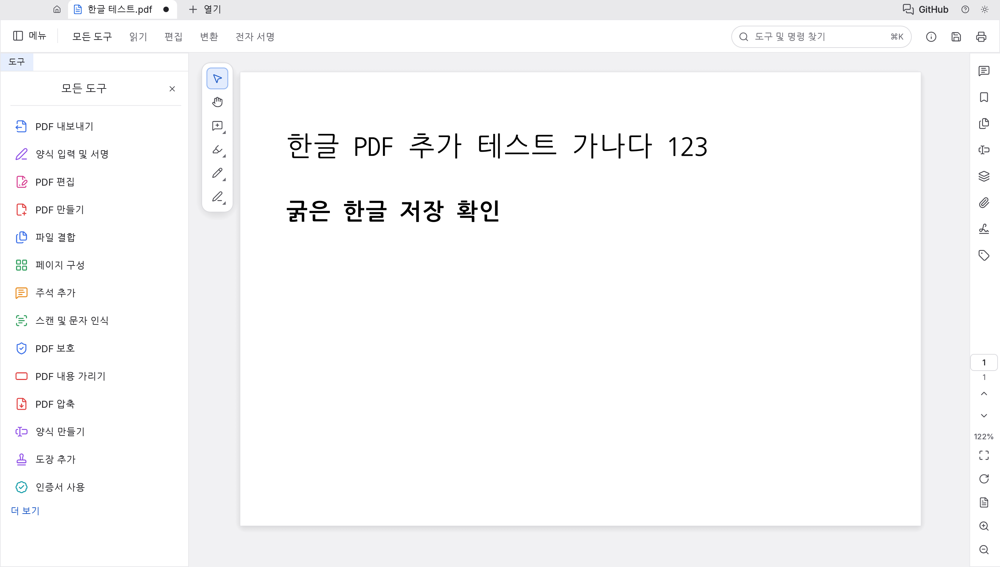

# KR-PdfCraft

albert8959의 한국어 사용 환경을 개선하기 위한 PdfCraft 기반 독립 포크입니다. ArtCraft 팀의 공식 제품이 아니며, 원본 팀의 지원·보증·승인을 의미하지 않습니다.



## 원본과 라이선스

- 원본: https://github.com/storytold/pdfcraft
- 기준 커밋: `3f044b6263aa6605c3aa44ca6d065e1ab37d13b6` (2026-10-14 체크아웃)
- 코드: [MIT](LICENSE-MIT) 또는 [Apache-2.0](LICENSE-APACHE). 원본 저작권 고지와 [NOTICE](NOTICE)를 유지합니다.
- 자산별 출처와 라이선스: [ATTRIBUTION.md](ATTRIBUTION.md).
- ArtCraft 상표 그림과 이를 포함한 홈 화면 스크린샷은 제거했습니다. 상표 조건은 [원본 조건](docs/brand/LICENSE-brand.txt)을 참고하세요.

## 이번 작업

- 언어 선택과 시스템 `ko-KR` 인식에 한국어를 등록합니다.
- 기본 메뉴·환경설정·주석·페이지 도구의 한국어 번역을 추가합니다. 아직 전체 번역이 아니며, 없는 문구는 영어로 표시합니다.
- 한국어 월·요일 이름을 날짜 언어에 추가합니다.
- macOS에 이미 설치된 Apple SD Gothic Neo를 UI 대체 글꼴로 읽는 경로를 추가합니다. 글꼴 파일을 복사·배포하거나 PDF에 넣지 않습니다.
- 선택적 한글 문서 글꼴 입력을 추가하고, 한글 본문 수정 시 해당 글꼴을 선택합니다. [글꼴 빌드 안내](docs/korean-fonts.md)를 참고하세요.
- 원본에 이미 포함된 macOS 한글 IME 첫 자모 처리 패치를 유지합니다. 이 포크가 새로 해결한 IME 수정이라고 주장하지 않습니다.

## 빌드와 실행

Rust 1.95 이상과 macOS Command Line Tools가 필요합니다.

```sh
git clone https://github.com/albert8959/KR-PdfCraft
cd KR-PdfCraft
cargo xtask korean-fonts ../craft-fonts-kr
CRAFT_FONTS_DIR="$PWD/../craft-fonts-kr" CRAFT_FONTS_REQUIRED=1 cargo run -p pdfcraft -j 2
```

환경설정 (`⌘,`)의 인터페이스 언어에서 `한국어`를 선택합니다. 자동 선택은 시스템 언어를 따릅니다. 위 방법으로 빌드하면 공개 라이선스의 한글 글꼴이 포함됩니다. 문서 글꼴 없이 빌드한 경우 UI에는 설치된 한글 글꼴을 사용할 수 있고, `PDFCRAFT_SYSTEM_FONTS=0`은 시스템 글꼴 읽기를 끕니다.

## 확인 범위와 남은 한계

검증 결과는 [docs/kr-validation.md](docs/kr-validation.md)에 기록합니다. 빌드·테스트·실제 앱 확인이 끝나기 전에는 사용 가능한 배포판이라고 보장하지 않습니다.

UI 표시와 PDF 문서 내부의 글꼴은 별개입니다. 이 변경만으로 PDF에 한글 텍스트를 추가·저장하는 모든 경로가 해결되는 것은 아닙니다. 위 빌드 방법의 공개 한글 글꼴을 사용한 본문 추가·수정·저장·재열기 회귀 테스트와 실제 PDF 렌더링은 확인했습니다. 임의의 기존 PDF나 모든 주석·양식 입력 경로가 해결됐다는 뜻은 아닙니다. 기존 PDF의 표시·검색 품질은 문서의 글꼴·인코딩 상태에 영향을 받습니다.

이번 배포 대상은 macOS입니다. 다른 플랫폼의 기존 패키징은 포크 배포용으로 검증되지 않았습니다.

한국어 OCR(개발용 패키지에는 OCR 모델 미포함), 전체 메뉴 번역, 한국어 입력기의 PDF 편집창·포커스 전환을 반복하는 수동 확인, Windows/Linux/Web 검증은 별도 과제입니다. 원본의 일반적인 PDF 편집·Office 변환 한계도 남아 있습니다.

설치 패키지를 만들더라도 Apple 개발자 서명·공증이 없는 개발용 빌드와 공식 배포판을 구분합니다. 업데이트 확인 링크는 이 포크의 Releases로 연결합니다. 설정·복구 폴더도 원본과 분리합니다. 초기 macOS 패키지는 원본 앱 아이콘 대신 시스템 기본 아이콘을 사용합니다.

개발용 macOS 설치 파일 재현: 위 글꼴을 준비하고 앱을 빌드한 뒤 `CRAFT_FONTS_DIR="$PWD/../craft-fonts-kr" packaging/macos/package.sh --development --arch aarch64 --skip-build`를 실행합니다. Apple Silicon 호스트용이며 정식 서명·공증은 포함하지 않습니다.

## GitHub 자동 검사

포크의 Actions를 활성화하면 PR에서 Linux/Windows 테스트와 웹 컴파일·라이선스 검사를 실행합니다. 정기 야간/주간 실행은 제거했고, 원본 전용 Windows ARM64 패키징과 자동 배포는 이 포크에서 실행하지 않습니다. macOS 개발용 패키지는 위의 로컬 빌드 절차를 사용합니다.

macOS의 실제 한글 입력기를 사용한 도구 검색창에서 기본 자모 조합, 조합 중 삭제, 공백 뒤 첫 자모와 Enter 확정을 확인했습니다. PDF 편집창의 실제 입력기 조합까지 모두 검증했다는 뜻은 아닙니다.
